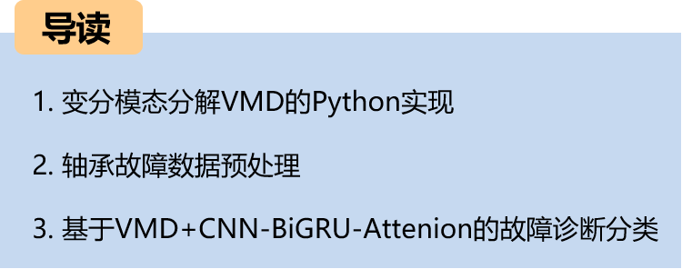
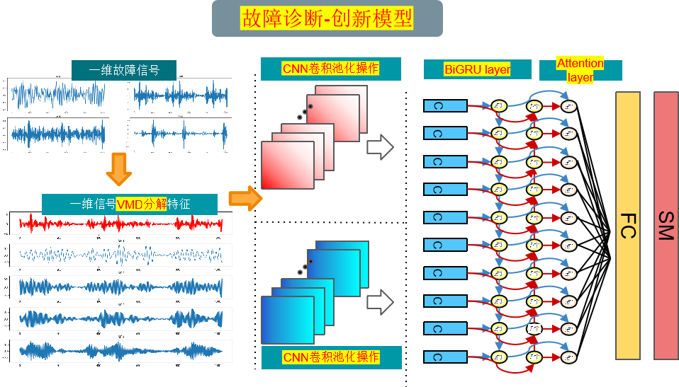
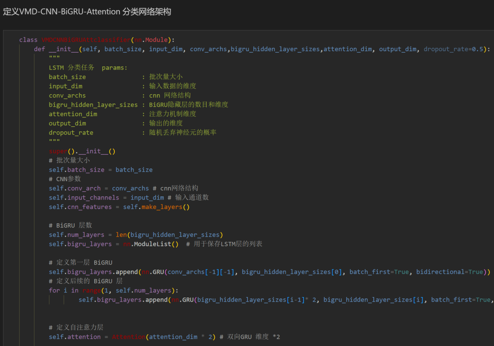
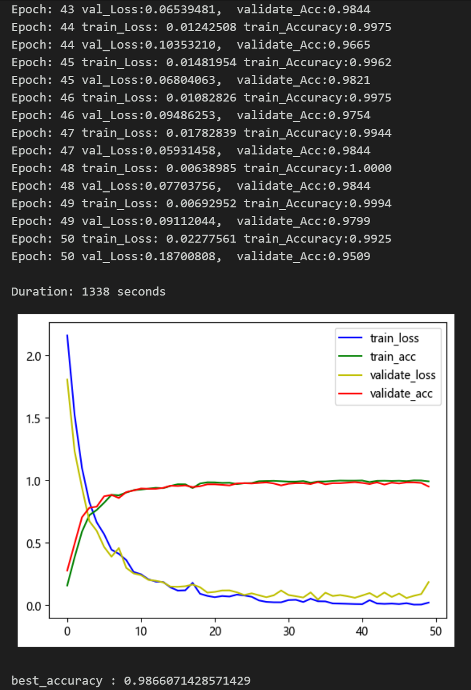
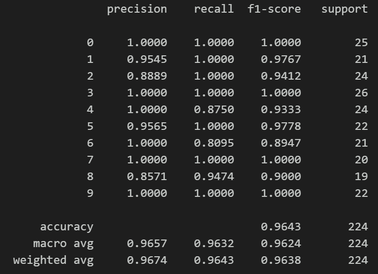
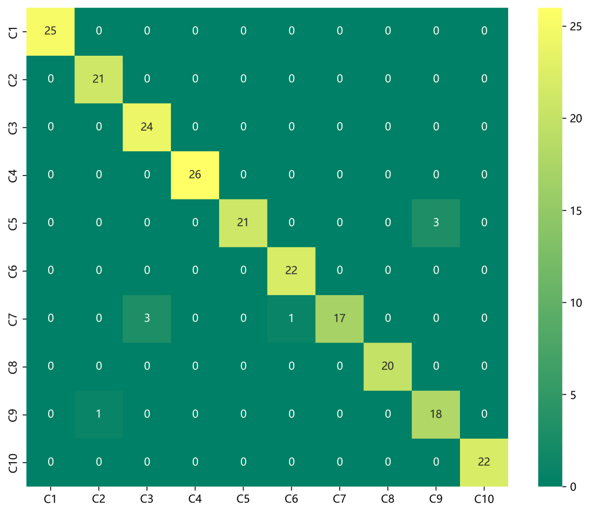
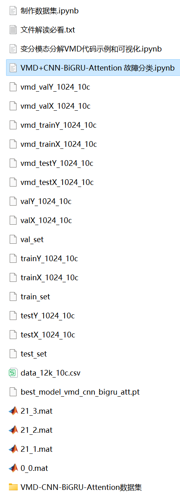
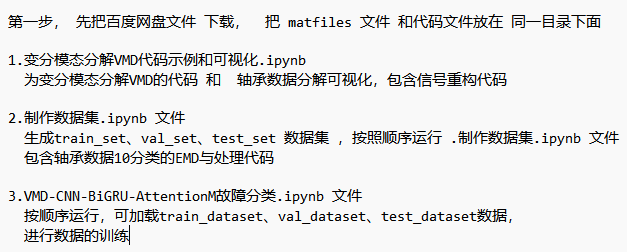

# Bearing Fault Innovation Model: Fault Identification Model with Feature Fusion and Attention Mechanism

The family set includes the following content:
- Python bearing fault diagnosis (11) Innovation in fault classification based on VMD+CNN-BiGRU-Attenion!!!
- Includes a complete bearing fault dataset, as well as fault signal datasets, classification data, and label sets that have been generated and ready for use. The corresponding code can be run, along with examples of Fast Fourier Transform (FFT).
- 50 epochs, accuracy 100%, significantly effective classification using the VMD+CNN-BiGRU-Attention network. The model is capable of fully extracting spatial and temporal features as well as frequency domain features from bearing fault signals. It converges quickly and performs exceptionally well, currently being the most accurate method among previous articles. Innovation is also present!!!
- Including code for data preprocessing and the VMD+CNN-BiGRU-Attention classification code.
Environment: Python 3.9
Preface
This article introduces the variational mode decomposition (VMD) and data preprocessing based on the Case Western Reserve University (CWRU) bearing data, and finally classifies fault data through the implementation of the VMD-CNN-BiGRU-Attenion mechanism for fusion of spatiotemporal features in multi-head attention. For a detailed introduction to the CWRU bearing data, please refer to the following article:
Python - Case Western Reserve University (CWRU) Bearing Data Interpretation and Classification Processing
Overall Model Structure
The overall structure of the model is as follows:
VMD Decomposition:
Input: Bearing vibration signal
Operation: Through VMD technology, the original signal is decomposed into multiple intrinsic mode functions (IMF)
Output: Each IMF represents vibration components within different frequency ranges
CNN feature extraction:
Input: IMFs obtained from VMD decomposition
Operation: Convolution and pooling operations are performed on each IMF to extract local features
Output: Convolution and pooling after feature representation, used to capture vibration characteristics at different frequencies
\tBiGRU-Attention Temporal Feature Extraction:
\tInput: Feature sequence extracted by CNN
Operation: Bidirectional GRU network learns sequential information, Attention mechanism focuses on important temporal features.
\tOutput: The temporal feature representation after BiGRU-Attention processing, with better temporal modeling capability.
Feature Enhancement:
\tInput: The temporal features extracted by BiGRU-Attention
Operation: Feature enhancement can be achieved through methods such as normalization, dimensionality reduction, and feature fusion to improve model performance and generalization capabilities.
1. Variational Mode Decomposition (VMD) in Python Example
\tStep 1, Installation and download of VMD package in Python:
# Download
pip install vmdpy  
# Import
From vmdpy import VMD  
Step 2, Import related packages for decomposition  
2. Preprocessing of bearing fault data  
2.1 Import data  
Refer to previous articles for the preprocessing of fault classification with 10 categories, using the Case Western Reserve University bearing data set:  
train_set, val_set, test_set are divided into training set, validation set, and test set in a ratio of 7:2:1, and finally save the data  
The above figure shows the form of data reading and the preprocessing idea  
2.2 Visualization of fault VMD decomposition  
First step, modality selection  
Based on different K values, observe the center frequency and select the K value; from K=4, it starts to appear similar center frequencies, indicating over-decomposition, so choose K=4 as the number of modalities.  
Second step, visualization of fault VMD decomposition  
2.3 Preprocessing of fault data through VMD decomposition  
3. Bearing Fault Diagnosis Classification Based on VMD-CNN-BiGRU-Attenion  
Below is the bearing fault diagnosis classification based on the VMD decomposition of bearings. First, through CNN for convolutional pooling operations to extract signal features, increase dimensionality, shorten the sequence length, then enter the BiGRU-Attenion layer to extract time series features, and enhance the features to achieve the signal classification method of CNN-BiGRU-Attenion:  
3.1 Define the VMD-CNN-BiGRU-Attenion classification network model  
3.2 Set parameters and train the model  
50 epochs, nearly 99% accuracy rate, the VMD-CNN-BiGRU-Attenion network classification effect is significant. The CNN-BiGRU-Attenion model can fully extract the spatial and temporal features of bearing fault signals, converges quickly, and has excellent performance. Further tuning of parameters can further improve the classification accuracy.  
Note to adjust parameters:
1. Adjust the number of CNN layers and hidden layer dimensions, fine-tune learning rates;
2. Modify the number of BiGRU layers and dimensionality, adjust the attention dimensionality, increase more epochs (note to prevent overfitting);
3. Change the shape of one-dimensional signal stacking (set appropriate length and dimension);
4. Model evaluation:
   - Accuracy, Precision, Recall, F1 Score
   - Fault classification confusion matrix:
     -

## Images

<!-- PAYMENT_BLOCK -->

## Get this dataset

- Payment link (Stripe): [Buy now](https://buy.stripe.com/3cs8yP7sY87d0vu9AB)
- Payment QR code: 

<!-- /PAYMENT_BLOCK -->
